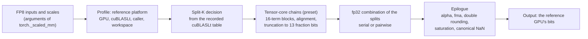

# mmaemu

**Bit-accurate emulation of NVIDIA tensor-core FP8 GEMM numerics for PyTorch: the bits of `torch._scaled_mm` on a
reference GPU (RTX 4060), computed on a CPU or another CUDA GPU.**

FP8 matrix multiplications on tensor cores do not round like IEEE arithmetic: the hardware aligns and truncates
blocks of products, cuBLAS may split K and add the partial sums in an order of its own choosing, and the
`torch._scaled_mm` epilogue rounds twice. Two GPUs can therefore return different bits for the same FP8 GEMM, and a
model trained with FP8 can depend on those bits. mmaemu recomputes such a GEMM exactly as a *reference GPU*
computes it (the accumulation inside the tensor core, the split-K reduction cuBLAS chooses, and the epilogue) and
returns the same bits on the CPU or on another CUDA GPU.

> **Status: v0.1.0, alpha.** One reference platform (RTX 4060, cuBLASLt 12.8.3.14) is modelled and validated
> against 173 recordings of its hardware. Read the [scope](#scope-and-limitations-of-v01) before relying on a
> result. The GPU tiers have passed on the RTX 4060 itself with the release kernels (conformance T3, live parity
> T3p, mutation matrix T4, performance T6), and the built wheel passed its release check (T7) on the RTX 4060 and
> on an RTX 5070 Ti ([release logs](https://github.com/astding/mmaemu/tree/master/docs/release_logs)).


- [Why mmaemu](#why-mmaemu)
- [Results](#results)
- [What mmaemu is for](#what-mmaemu-is-for)
- [How it works](#how-it-works)
- [Install](#install) and [quickstart](#quickstart)
- [Evo 2 on an RTX 50-series GPU](#evo-2-on-an-rtx-50-series-blackwell-gpu)
- [Scope and limitations](#scope-and-limitations-of-v01)
- [Related work](#related-work)
- [Documentation](#documentation), [citation](#citation), [licence](#licence)

## Why mmaemu

[Evo 2](https://github.com/ArcInstitute/evo2) is a DNA language model whose checkpoints compute their input
projections as FP8 GEMMs through NVIDIA Transformer Engine. On an RTX 5070 Ti (Blackwell, sm_120) the
1B model scores a loss of 1.248 on the upstream test, where 0.502 is expected, and 1.365 with FP8 disabled
([evo2 issue #157](https://github.com/ArcInstitute/evo2/issues/157)). The weights are fine; what differs is the FP8
GEMM arithmetic of the GPU and of the cuBLAS kernels it runs. The upstream README now lists FP8 through Transformer
Engine on a Hopper GPU as a requirement for the 1B, 20B and 40B checkpoints.

mmaemu takes the hardware out of those GEMMs. Routed through `mmaemu.scaled_mm`, each FP8 projection of Evo 2 1B
returns exactly the bits that Transformer Engine produces on an RTX 4060 (Ada, sm_89), while the model runs on the
RTX 5070 Ti. The loss on the upstream test returns to 0.5027 (computed as the test does, like the 1.248 above), and
zero-shot BRCA1 variant scoring agrees with the official result nearly as closely as the official path on an H100
does. The 40B model runs the same way on the same 16 GB GPU, with its weights in host RAM and one block at a time on
the GPU: its upstream-test loss is 0.2161, where 0.2159 is expected (native FP8 on the RTX 5070 Ti: 1.4023). The 7B
and 20B models were not run. mmaemu reproduces the RTX 4060's FP8 GEMMs, not Hopper's. The same arithmetic is
available wherever it is needed: on the CPU, in CI, or on a GPU whose FP8 path behaves differently.

## Results

All Evo 2 numbers below except the issue #157 row (evo2 0.3.0, TE 2.5.0) and the 40B section are for Evo 2 1B
(`evo2_1b_base`), evo2 0.6.0, torch 2.7.1+cu128 and cuBLASLt 12.8.3.14.
"Official" is the upstream path: `evo2.Evo2` with Transformer Engine 2.3.0 FP8. The RTX 5070 Ti rows come from
[examples/evo2_blackwell.ipynb](https://github.com/astding/mmaemu/blob/master/examples/evo2_blackwell.ipynb)
([log](https://github.com/astding/mmaemu/tree/master/docs/validation_logs/2026-10-14/evo2-rtx-5070-ti)), the
H100 rows from a rented H100 PCIe
([log](https://github.com/astding/mmaemu/tree/master/docs/validation_logs/2026-10-14/evo2-h100-sm90)).

### Evo 2 1B on the upstream test

The four test prompts of `evo2/test/test_evo2.py`: next-token cross entropy (computed in fp32 from the bf16
logits) and argmax accuracy.

| Platform | FP8 projections computed by | Loss | Accuracy |
|---|---|---:|---:|
| expected by the upstream test | | 0.502 | 0.7956 |
| RTX 4060 (Ada, sm_89) | official TE FP8 (the reference) | 0.5024 | 0.7951 |
| H100 PCIe (Hopper, sm_90) | official TE FP8 | 0.5026 | 0.7953 |
| **RTX 5070 Ti (Blackwell, sm_120)** | **mmaemu (`profile="ada-rtx4060-te"`)** | **0.5025** | **0.7960** |
| RTX 5070 Ti | native FP8 (`torch._scaled_mm`) | 1.2488 | 0.3848 |
| RTX 5070 Ti | bf16 GEMMs, no FP8 (`use_fp8_input_projections=False`, evo2's 7B fallback; it refuses to load 1B without TE) | 1.3642 | 0.3262 |
| RTX 5070 Ti, issue #157 | TE 2.5.0 FP8 / FP8 disabled | 1.248 / 1.365 | |

Computed as the upstream test does it (in bf16, on the GPU), the native and bf16 rows give 1.2480 and 1.3652: the
numbers reported in issue #157.

### One FP8 GEMM, bit for bit

The first FP8 projection of the model (block 0 on a 2,048-bp window: M = 2048, N = 5760, K = 1920, bf16 output),
against the SHA-256 of the input, weight and Transformer Engine output recorded on the RTX 4060:

| On the RTX 5070 Ti | E4M3 input | E4M3 weight | bf16 output |
|---|---|---|---|
| mmaemu | equal | equal | **equal, bit for bit** |
| native FP8 | equal | equal | 8,293,802 of 11,796,480 values differ (70.3%), max \|Δ\| 0.31 |

A 32-row slice of the same projection computed by mmaemu on the CPU equals the GPU result bit for bit (T2 replays
the full projection on the CPU). Over all 21 FP8 projections of that window, mmaemu's fp32 accumulators equal the
RTX 4060 recording on the RTX 5070 Ti (v4, the default there, on the release fatbins; v1, v4 and (opted in) v9 in
the development run of 13 Oct), and its accumulators and bf16 outputs equal it on the H100 (v1 and v4 compiled by NVRTC from
5c15e8a), where native FP8 differs on all 21.

### The whole model

mmaemu emulates the FP8 GEMMs only; the other operations of the model (bf16 matrix products, convolutions,
normalisations) run natively, so full-model logits differ from the RTX 4060's at the level at which any two GPUs
running the official path differ. Six windows (the four test prompts, and the first 8,192 bp and 2,048 bp of their
concatenation), compared with the official RTX 4060 output:

| Platform | Mean \|Δ log p(A,C,G,T)\| | Most likely base agrees | Max \|Δ sequence score\| |
|---|---:|---:|---:|
| H100, official TE FP8 | 0.0411 (0.035-0.049) | 99.41% | 0.0009 |
| RTX 5070 Ti + mmaemu | 0.0403 (0.035-0.047) | 99.42% | 0.0016 |
| RTX 5070 Ti, native FP8 | 2.58 (1.91-3.46) | 43.0% | 1.12 |
| RTX 5070 Ti, bf16 GEMMs | 2.85 (1.89-3.48) | 37.0% | 1.15 |

Mean over the six windows, range in brackets. With mmaemu the distance to the reference is of the same size as the
distance between the official runs on two different GPUs; native FP8 and bf16 are about 65 and 70 times further
away.


### Zero-shot BRCA1 variant effect prediction

The task of the upstream [BRCA1 notebook](https://github.com/ArcInstitute/evo2/tree/main/notebooks/brca1): score
8,192-bp windows around the single-nucleotide variants measured by Findlay et al. (2018), and separate
loss-of-function variants by the score change Δ. The same random subset of 500 variants (111 loss of function) on
every platform:

| Platform | AUROC | Δ Pearson vs RTX 4060 | Δ Spearman vs RTX 4060 | Max \|Δ sequence score\| |
|---|---:|---:|---:|---:|
| RTX 4060, official TE FP8 | 0.7378 | 1 | 1 | 0 |
| H100, official TE FP8 | 0.7332 | 0.987 | 0.922 | 0.0004 |
| **RTX 5070 Ti + mmaemu** | **0.7323** | **0.986** | **0.912** | **0.0004** |
| RTX 5070 Ti, native FP8 | 0.5586 | 0.059 | 0.165 | 0.18 |
| RTX 5070 Ti, bf16 GEMMs | 0.4842 | 0.069 | 0.078 | 0.62 |

With mmaemu the RTX 5070 Ti scores the variants almost the way the official path does on another GPU: its AUROC
(0.732) is nearly as close to the RTX 4060's (0.738) as the H100's is (0.733), and its per-variant score changes
follow the RTX 4060's almost as closely as the H100's do (Pearson 0.986 against 0.987, Spearman 0.912 against
0.922; same sign for 84.0% and 84.2% of the variants). Native
FP8 on the RTX 5070 Ti drops the AUROC to 0.559, and bf16 GEMMs to 0.484, below chance; in both cases the
per-variant score changes are essentially unrelated to the official ones (Pearson 0.06-0.07). The score changes are
small (mean \|Δ\| 6e-4 on the RTX 4060), which is why even two official GPUs agree on them only to Pearson 0.987.


### Evo 2 40B

The original 40B checkpoint (82 GB) on the same RTX 5070 Ti, with its weights in host RAM and one block at a time
on the GPU (evo2 0.6.0, torch 2.7.1+cu128; [log](https://github.com/astding/mmaemu/tree/master/docs/validation_logs/2026-10-15/evo2-40b-rtx-5070-ti)).
The upstream test, with the loss in fp32 as in the 1B table:

| Platform | FP8 projections computed by | Loss | Accuracy |
|---|---|---:|---:|
| expected by the upstream test | | 0.2159 | 0.9167 |
| H100 PCIe (Hopper, sm_90), official path ([log](https://github.com/astding/mmaemu/tree/master/docs/validation_logs/2026-10-15/evo2-40b-h100-sm90)) | Transformer Engine FP8 | 0.2160 | 0.9167 |
| **RTX 5070 Ti (Blackwell, sm_120)** | **mmaemu (`profile="ada-rtx4060-te"`)** | **0.2158** | **0.9169** |
| RTX 5070 Ti | native FP8 (`torch._scaled_mm`) | 1.4048 | 0.2568 |
| RTX 5070 Ti | bf16 GEMMs, no FP8 | 1.4057 | 0.2559 |

Computed as the upstream test does it, the RTX 5070 Ti's three losses are 0.2161, 1.4023 and 1.4043, and the
H100's is 0.2159424, the expected value. On two windows (the first 2,048 and 4,096 bp of the prompts'
concatenation), mmaemu's mean \|Δ log p(A,C,G,T)\| is 0.031 and 0.029 from the official path on the RTX 4060 and
0.0295 and 0.0288 from the official path on the H100, which are 0.030 and 0.029 from each other (native FP8: 3.97
and 4.07). On the first 100 of the notebook's 500 BRCA1 variants (20 loss-of-function), the 40B with mmaemu gives an
AUROC of 0.855, as the official 40B on the H100 does, and its per-variant score changes follow the H100's with
Pearson 0.998 (natively with FP8: AUROC 0.503, Pearson 0.17; with bf16 GEMMs: 0.590, 0.19). On all 500 variants the
official 40B gives 0.868.

### Validation by platform

| Platform | What ran | Result |
|---|---|---|
| RTX 4060 (Ada, sm_89, 24 SMs) | the hardware recordings: 173 recordings, 2.5 billion output values (instruction level, cuBLAS GEMMs, epilogue, special values, split-K, Evo 2 projections); T3, T3p and T6 on the release kernels; GPU mutation matrix (NVRTC builds of the mutated sources) | the reference; T2 replays the recordings through mmaemu on the CPU: PASS (every modelled output of 147 recordings equals the hardware, apart from the old emulator recording's 6,120 NaN-decode outputs; the 15 tables are not replayed). T3 and the full Evo 2 accumulators pass with every kernel (tc3, v9, v4, v1); T3p: live `torch._scaled_mm` equals mmaemu's reference bit for bit; T6: every kernel above its speed threshold |
| RTX 5070 Ti (Blackwell, sm_120, 70 SMs) | T3 on the release kernels; GPU mutation matrix (NVRTC builds of the mutated sources, 5f1a55c); full device independence (v1, v4, v9) and a development wheel installed without nvcc (NVRTC fallback), 13 Oct | all pass; v1 and v4 validated (bitwise equal to the CPU reference); gated v9 opt-in; no tc3 binary for sm_120 |
| H100 PCIe (Hopper, sm_90, 114 SMs) | T3 on the release fatbins; Evo 2 fixed inputs (21 projections) with v1 and v4 compiled by NVRTC from 5c15e8a | all pass; 21 of 21 bitwise equal to the RTX 4060; sm_90 not yet in the validated set (the full device-independence suite did not run there) |
| CPU (x86_64) | T0 + T1 in CI on Python 3.10-3.13 x torch 2.6.0, 2.7.1 and the latest ([CI run](https://github.com/astding/mmaemu/blob/master/docs/validation_logs/2026-10-14/ci/README.md) on the code of 8429385; the review's fixes passed the CI steps run locally by `tools/ci_local.sh`, on Python 3.12 x torch 2.6.0, 2.7.1 and the latest: [log](https://github.com/astding/mmaemu/blob/master/docs/validation_logs/2026-10-15/ci-local/README.md)); CPU mutation matrix (T4) | all pass; 43 mutants killed, 2 equivalent, identity controls survive |

Details, with a reference to the log or recording behind every number:
[docs/validation.md](https://github.com/astding/mmaemu/blob/master/docs/validation.md).

### Speed

Exact emulation costs more than native FP8. On the RTX 4060, the reference GPU, the release kernels sustain
(T6: CUDA events, M = 2048, at the card's 115 W power limit):


| Kernel | Evo 2 1B (K 1920, N 5760) | 7B (K 4096, N 12288) | 40B (K 8192, N 24576) |
|---|---:|---:|---:|
| native `torch._scaled_mm` (fast accumulation; not exact) | 29.8 TMAC/s | 30.4 TMAC/s | 30.5 TMAC/s |
| `cuda:tc3` (gated; AUTO's choice on sm_89) | 2.94 TMAC/s | 2.93 TMAC/s | 2.94 TMAC/s |
| `cuda:v9` (gated) | 1.53 TMAC/s | 1.54 TMAC/s | 1.54 TMAC/s |
| `cuda:v4` (IEEE-exact, sm_80+) | 1.34 TMAC/s | 1.36 TMAC/s | 1.37 TMAC/s |
| `cuda:v1` (IEEE-exact, sm_75+) | 0.63 TMAC/s | 0.63 TMAC/s | 0.63 TMAC/s |

The exact GEMM with tc3 runs at about a tenth of the native rate there. On the RTX 5070 Ti (development build with
the release flags, M = 2048, CUDA events) the IEEE-exact kernels are faster, and tc3 has no binary:


| Kernel | Evo 2 1B (K 1920, N 5760) | 7B (K 4096, N 12288) | 40B (K 8192, N 24576) |
|---|---:|---:|---:|
| `cuda:v1` (IEEE-exact, sm_75+) | 1.94 TMAC/s | 1.97 TMAC/s | 1.98 TMAC/s |
| `cuda:v4` (IEEE-exact, sm_80+; the default here) | 3.99 TMAC/s | 4.31 TMAC/s | 4.38 TMAC/s |
| `cuda:v9` (gated, opt-in on sm_120) | 4.82 TMAC/s | 5.15 TMAC/s | 5.11 TMAC/s |

End to end on the RTX 5070 Ti, an Evo 2 1B forward pass over 8,192 bp takes about 1.0 s with mmaemu and 0.45 s
with native FP8, and scoring the 935 BRCA1 windows takes about 16 and 7 minutes (host timer). Method, MAC per
clock, small-M rates and the logs: [performance](https://github.com/astding/mmaemu/blob/master/docs/performance.md).

## What mmaemu is for

- **Running FP8-trained models on other GPUs.** When an FP8 model scores differently on another GPU, reproduce the
  reference GPU's FP8 GEMMs inside it (Evo 2 1B on an RTX 5070 Ti, above: loss 0.5027 instead of 1.248; Evo 2 40B
  on the same GPU: 0.2161 instead of 1.4023, and on 100 BRCA1 variants the AUROC of the official 40B on an H100).
- **Reproducing FP8 results without the GPU.** Compute the reference GPU's exact `torch._scaled_mm` outputs on a
  CPU, in CI or on a laptop: golden outputs for regression tests, checking published numbers computed on the
  reference platform, archives.
- **Golden references for kernels and hardware.** Compare a custom FP8 kernel, a new cuBLAS version or a new GPU
  with the reference GPU's bit-exact outputs; `mmaemu.testing.assert_bitwise_equal` locates any difference by
  class (zero sign, NaN payload, value). A difference on another platform is not by itself a bug.
- **Debugging cross-GPU discrepancies.** Replace a model's FP8 GEMMs with mmaemu on two machines: whatever still
  differs comes from the other operations. `mmaemu.explain` shows the split-K decision and backend of a call.
- **Numerics research.** Study how block truncation, accumulation order, split-K and double rounding affect a
  model: the instruction model (`mmaemu.model.dot`) and the presets expose each of these, and a custom `Preset`
  evaluates a hypothetical accumulator design.

Other potential uses, outside what v0.1 has been validated for:

- reproducible FP8 inference across cloud GPU types, by pinning the FP8 GEMMs to one platform;
- auditing FP8 experiments: recomputing the GEMMs of a reported run and locating where a rerun diverges;
- characterising a new GPU's FP8 arithmetic with the probes and recordings of the bring-up runbook, and adding it
  as a new reference platform;
- teaching what tensor cores actually compute.

## How it works



- **Preset**: the arithmetic of one tensor-core instruction. The `ada` preset follows the model of Khattak and
  Mikaitis ([citation](#citation)) and is re-validated on RTX 4060 recordings.
- **Profile**: the platform of a GEMM call: GPU and SM count, cuBLASLt version, caller and its workspace size, the
  split-K table recorded on that GPU, and what its cuBLAS rejects.
- **Backends**: the same arithmetic as a float64 reference model (CPU or GPU) and as CUDA kernels that use only
  IEEE-defined instructions (v1, v4) or, gated by per-device self-tests, the tensor cores themselves (v9, tc3).
  Every backend returns the reference model's bits.
- **Evidence first**: a behaviour ships as *validated* only when hardware recordings reproduce it bit for bit;
  otherwise it is *experimental* (it warns) or it raises. Two documented exceptions, both for shapes missing from
  the split-K table and both shown by `explain`: on the reference GPU a live cuBLASLt query decides
  (`source='live-query'`); elsewhere, when M*N is more than twice every split M*N of the setting, S = 1 is inferred
  (`source='envelope'`; `MMAEMU_SPLITK_STRICT=1` makes such shapes raise).

The full numerics contract is in [docs/semantics.md](https://github.com/astding/mmaemu/blob/master/docs/semantics.md).

## Install

Until 0.1.0 is published on PyPI, install from this repository:

    pip install "git+https://github.com/astding/mmaemu"

After the release: `pip install mmaemu`.

Requirements: Python >= 3.10, PyTorch >= 2.6, NumPy. No CUDA toolkit, nvcc or C++ compiler is needed. The package
contains prebuilt kernels (fatbins) that are loaded through the NVIDIA driver. If they cannot be used, mmaemu
compiles the shipped kernel sources with NVRTC (`libnvrtc` comes with PyTorch's CUDA wheels), and otherwise falls
back to the exact reference model on the tensor's device, with one `BackendFallbackWarning`.

Check an installation:

    python -m mmaemu info       # versions, device, matching profiles, backend status with reasons, presets
    python -m mmaemu selftest   # runs the kernel self-tests on the GPU (exit 0 = all required kernels passed)

## Quickstart

On the CPU:

```python
import torch
import mmaemu

torch.manual_seed(0)
x = (torch.randn(64, 1920) * 40).clamp(-448, 448).to(torch.float8_e4m3fn)    # input  [M, K], row-major
w = (torch.randn(5760, 1920) * 40).clamp(-448, 448).to(torch.float8_e4m3fn)  # weight [N, K]
scale_x = torch.tensor(1 / 64)
scale_w = torch.tensor(1 / 32)

# The arguments of torch._scaled_mm: mat2 is [K, N] column-major, i.e. w.t().
y = mmaemu.scaled_mm(x, w.t(), scale_x, scale_w, out_dtype=torch.bfloat16, use_fast_accum=True)

acc = mmaemu.accumulate(x, w, use_fast_accum=True)   # the fp32 accumulator before scaling, [M, N]
print(mmaemu.explain(x, w.t(), scale_x, scale_w, out_dtype=torch.bfloat16, use_fast_accum=True))
```

On a GPU the same call runs the CUDA kernels and gives the same bits:

```python
yg = mmaemu.scaled_mm(x.cuda(), w.cuda().t(), scale_x.cuda(), scale_w.cuda(),
                      out_dtype=torch.bfloat16, use_fast_accum=True)
mmaemu.testing.assert_bitwise_equal(yg.cpu(), y)     # compares bit patterns: +0 != -0, NaN payloads
```

On the reference GPU itself (RTX 4060, cuBLASLt 12.8.3.14, torch 2.7.1), `yg` also equals the native
`torch._scaled_mm(x.cuda(), w.cuda().t(), scale_a=..., scale_b=..., out_dtype=torch.bfloat16, use_fast_accum=True)`.

Good to know:

- Defaults follow torch: `use_fast_accum=False`, and `out_dtype` is the input dtype. Evo 2 uses
  `use_fast_accum=True` with bf16 output. `mmaemu.accumulate` has no default for `use_fast_accum`.
- `profile=` selects the platform: `"ada-rtx4060-torch"` (default) for `torch._scaled_mm`, `"ada-rtx4060-te"`
  for results produced by Transformer Engine.
- `splitk="auto"` takes cuBLAS's split-K decision from a table recorded on the reference GPU. If it cannot decide
  for your shape it raises `SplitKUnknownError` rather than guess; pass `splitk=1` or `splitk=(S, "serial")` /
  `(S, "pairwise")` explicitly.
- `mmaemu.explain(...)` shows the profile, preset maturity, split-K decision and its source, the backend and
  any fallback, without running the GEMM; `python -m mmaemu explain M N K --out bf16 --fast` does the same from
  the shell.

More in the [user guide](https://github.com/astding/mmaemu/blob/master/docs/user_guide.md).

## Evo 2 on an RTX 50-series (Blackwell) GPU

[examples/evo2_blackwell.ipynb](https://github.com/astding/mmaemu/blob/master/examples/evo2_blackwell.ipynb) runs
upstream Evo 2 1B on an RTX 5070 Ti without Transformer Engine. One self-contained cell puts the FP8 GEMM back into
the model's 21 FP8 projections, using the FP8 scales stored in the checkpoint; its core is one call:

```python
y = mmaemu.scaled_mm(xq, wq.t(), 1 / scale_x, 1 / scale_w, out_dtype=torch.bfloat16,
                     use_fast_accum=True, profile="ada-rtx4060-te")
```

The notebook then checks one GEMM against the RTX 4060's recorded output, compares the whole model on six windows
with the official RTX 4060 and H100 runs, and repeats the zero-shot BRCA1 experiment. The RTX 4060 reference
outputs ship in `examples/data/`, so no second GPU is needed. Guide and discussion:
[docs/evo2.md](https://github.com/astding/mmaemu/blob/master/docs/evo2.md).

For Evo 2 40B, [examples/evo2_offload.py](https://github.com/astding/mmaemu/blob/master/examples/evo2_offload.py)
runs the upstream model with the same projection, its weights in host RAM (82 GB for the 40B) and one block at a time
on the GPU:

```bash
python examples/evo2_offload.py test --model evo2_40b --checkpoint evo2_40b.pt    # the upstream test: PASS or FAIL
python examples/evo2_offload.py score --model evo2_40b --checkpoint evo2_40b.pt --input seqs.fasta --out scores.tsv
```

The results above were measured on an RTX 5070 Ti. In evo2 issue #157 an RTX 5090, also an RTX 50-series GPU
(sm_120), shows the same failure; mmaemu was not run on it. An alternative that needs no emulation is NVIDIA
BioNeMo's Evo 2 1B checkpoint fine-tuned for bf16, `evo2/1b-8k-bf16:1.0`
([BioNeMo Evo 2 documentation](https://docs.nvidia.com/bionemo-framework/latest/main/developer-guide/bionemo-evo2/bionemo-evo2-Overview/)).
It has other weights than the original checkpoint, which is the one mmaemu runs.

## Scope and limitations of v0.1

- **Reference platform:** NVIDIA GeForce RTX 4060 (Ada, sm_89, 24 SMs) with cuBLAS/cuBLASLt 12.8.3.14, called
  through torch 2.7.1 `torch._scaled_mm` (1 MiB cuBLAS workspace) or Transformer Engine 2.3 (4 MiB). In this scope
  mmaemu's outputs equal the reference GPU's outputs bit for bit on the recorded evidence
  ([validation](https://github.com/astding/mmaemu/blob/master/docs/validation.md)).
- **Formats:** FP8 inputs E4M3 x E4M3 or mixed E4M3/E5M2 (E5M2 x E5M2 is rejected, as by torch), tensor-wise
  scales; fp32, bf16, fp16 and E4M3 outputs, and E5M2 output from mixed inputs.
- **Devices:** the CPU (exact float64 reference model in plain torch; CI on Linux x86_64) and NVIDIA GPUs through
  prebuilt CUDA kernels. The CUDA kernels are tested on Linux x86_64 (WSL2 included). They load wherever
  `libcuda.so.1` is found (Linux aarch64 is untested); on native Windows and macOS the reference backend is used. Every kernel passes a self-test on the device before it is used.
  The IEEE-exact kernels v1 and v4 are validated on sm_89 and sm_120, the gated kernels v9 and tc3 on sm_89 only;
  on other GPUs the kernels are self-test gated but not yet validated (sm_90 passed T3).
- **Presets** (the tensor-core arithmetic): `ada` is validated.
- The `hopper` preset is **experimental**: it reproduces the toolbox's H100/H200 instruction-level vectors, which
  were recorded with c = 0, and nothing at GEMM level.
- The `b200_mma_sync` preset (alias `blackwell`) is **experimental**: it fits the toolbox's B200 `mma.sync`
  vectors (an fp16 HMMA rewrite of the instruction), not B200 cuBLAS. Both experimental presets warn when used.
- **sm_120 is not modelled** (RTX 50-series GPUs such as the RTX 5070 Ti): mmaemu ships no preset, profile or
  split-K table for it, and `b200_mma_sync` is not such a model. Khattak and Mikaitis (arXiv:2512.07004v4,
  section 4.1.8, Tables 3-4) report RTX PRO 6000 (sm_120) tensor-core numerics identical to the B200's; probes on
  an RTX 5070 Ti are consistent with that model
  ([log](https://github.com/astding/mmaemu/tree/master/docs/validation_logs/2026-10-13-sm120)), but it is not
  validated at GEMM level. mmaemu runs on these GPUs, emulating the RTX 4060.
- **Inference only:** no bias, no row-wise scales, no autograd. Unsupported features raise instead of
  approximating.
- **Whole models:** mmaemu emulates the FP8 GEMMs routed through it. The rest of a model runs natively, so
  full-model outputs are close to the reference GPU's, not bit-identical (see the Evo 2 results above).

The full list is in [docs/limitations.md](https://github.com/astding/mmaemu/blob/master/docs/limitations.md):
split-K decisions come from the reference platform's recorded table (shapes it cannot resolve raise); CUDA graph
capture is not supported; E5M2 and mixed-format inputs run on the (slow) reference backend; the CUDA kernels are
tested on Linux x86_64 only; mmaemu reproduces the reference GPU, it does not predict another GPU's native FP8
results.

## Related work

mmaemu builds on the tensor-core models of Khattak and Mikaitis (see [Citation](#citation)). Other projects model
GPU floating-point arithmetic at other levels:

- [MMA-Sim](https://github.com/microsoft/MMA-Sim) (Xie et al., [arXiv:2511.10909](https://arxiv.org/abs/2511.10909)):
  bit-accurate Python models of the matrix instructions (`mma.sync`, `wgmma`, `tcgen05`, `v_mfma`) of ten GPU
  architectures, from NVIDIA Volta to RTX Blackwell and AMD CDNA1 to CDNA3, in formats from FP64 to FP8 and FP4.
- Hawkeye (Badash, Boneh, Komargodski and Srivastava, MLSys 2026,
  [arXiv:2603.20421](https://arxiv.org/abs/2603.20421), [code](https://github.com/badasherez/gpu-simulator)):
  re-executes tensor-core matrix multiplications on a CPU; the paper reports FP16, BF16 and FP8 on Ampere, Hopper
  and Lovelace GPUs.
- [FPRev](https://github.com/peichenxie/FPRev) (Xie et al., USENIX ATC 2025): reveals the accumulation order of
  floating-point implementations in software and hardware.
- [hardware_rounding_error_predictor](https://github.com/NaciCankaya/hardware_rounding_error_predictor) (Cankaya,
  [arXiv:2606.00279](https://arxiv.org/abs/2606.00279)): bit-exact re-computation of bf16 transformer inference on
  A100, L40S and H100 GPUs, including the cuBLAS kernel choice and its split-K variants.

mmaemu's scope is the FP8 GEMM as PyTorch calls it: `torch._scaled_mm` on one reference platform (RTX 4060,
cuBLASLt 12.8.3.14), with the tensor-core accumulation, the split-K plan cuBLASLt chooses and the epilogue,
validated against 173 recordings of that GPU. Its CUDA kernels return the same bits on the GPUs where they are
validated (tc3: 2.94 TMAC/s on the RTX 4060; v4: about 4 TMAC/s on an RTX 5070 Ti).

## Documentation

- [Documentation site](https://astding.github.io/mmaemu/) (the pages of `docs/`), or the
  [documentation index](https://github.com/astding/mmaemu/blob/master/docs/index.md) on GitHub
- [User guide](https://github.com/astding/mmaemu/blob/master/docs/user_guide.md),
  [API reference](https://github.com/astding/mmaemu/blob/master/docs/api.md),
  [Evo 2 guide](https://github.com/astding/mmaemu/blob/master/docs/evo2.md),
  [FAQ](https://github.com/astding/mmaemu/blob/master/docs/faq.md)
- [Semantics](https://github.com/astding/mmaemu/blob/master/docs/semantics.md): exactly what is computed.
- [Presets and profiles](https://github.com/astding/mmaemu/blob/master/docs/presets_profiles.md): maturity,
  split-K resolution, environment variables.
- [Validation](https://github.com/astding/mmaemu/blob/master/docs/validation.md),
  [limitations](https://github.com/astding/mmaemu/blob/master/docs/limitations.md),
  [performance](https://github.com/astding/mmaemu/blob/master/docs/performance.md),
  [testing](https://github.com/astding/mmaemu/blob/master/docs/testing.md),
  [releasing](https://github.com/astding/mmaemu/blob/master/docs/release.md),
  [changelog](https://github.com/astding/mmaemu/blob/master/CHANGELOG.md).

## Citation

If you use mmaemu, please cite it ([CITATION.cff](https://github.com/astding/mmaemu/blob/master/CITATION.cff)):

```bibtex
@software{mmaemu,
  author  = {Ding, Xun},
  title   = {mmaemu: bit-accurate emulation of {NVIDIA} tensor-core {FP8} {GEMM} numerics},
  version = {0.1.0},
  year    = {2026},
  url     = {https://github.com/astding/mmaemu}
}
```

and the tensor-core model and toolbox it builds on:

```bibtex
@article{khattak2026accurate,
  title   = {Accurate Models of {NVIDIA} Tensor Cores},
  author  = {Khattak, Faizan A. and Mikaitis, Mantas},
  journal = {ACM Transactions on Architecture and Code Optimization},
  volume  = {23},
  number  = {3},
  pages   = {1--25},
  year    = {2026},
  doi     = {10.1145/3830409},
  note    = {arXiv:2512.07004}
}

@software{matlab_tensor_core,
  title   = {{MATLAB} Tensor Core toolbox},
  author  = {Khattak, Faizan A. and Mikaitis, Mantas},
  year    = {2025},
  url     = {https://github.com/north-numerical-computing/MATLAB-tensor-core}
}
```

If you use the Evo 2 results or the notebook, please also cite Evo 2 and, for the BRCA1 experiment, the saturation
genome editing data:

```bibtex
@article{Brixi2026,
  title   = {Genome modelling and design across all domains of life with {Evo} 2},
  author  = {Brixi, Garyk and Durrant, Matthew G. and Ku, Jerome and Naghipourfar, Mohsen and Poli, Michael and
             Sun, Gwanggyu and Brockman, Greg and Chang, Daniel and Fanton, Alison and Gonzalez, Gabriel A. and
             King, Samuel H. and Li, David B. and Merchant, Aditi T. and Nguyen, Eric and Ricci-Tam, Chiara and
             Romero, David W. and Schmok, Jonathan C. and Taghibakhshi, Ali and Vorontsov, Anton and Yang, Brandon
             and Deng, Myra and Gorton, Liv and Nguyen, Nam and Wang, Nicholas K. and Pearce, Michael T. and
             Simon, Elana and Adams, Etowah and Amador, Zachary J. and Ashley, Euan A. and Baccus, Stephen A. and
             Dai, Haoyu and Dillmann, Steven and Ermon, Stefano and Guo, Daniel and Herschl, Michael H. and
             Ilango, Rajesh and Janik, Ken and Lu, Amy X. and Mehta, Reshma and Mofrad, Mohammad R. K. and
             Ng, Madelena Y. and Pannu, Jaspreet and R{\'e}, Christopher and St. John, John and Sullivan, Jeremy
             and Tey, Joseph and Viggiano, Ben and Zhu, Kevin and Zynda, Greg and Balsam, Daniel and Collison,
             Patrick and Costa, Anthony B. and Hernandez-Boussard, Tina and Ho, Eric and Liu, Ming-Yu and
             McGrath, Thomas and Powell, Kimberly and Pinglay, Sudarshan and Burke, Dave P. and Goodarzi, Hani
             and Hsu, Patrick D. and Hie, Brian L.},
  journal = {Nature},
  volume  = {652},
  number  = {8112},
  pages   = {1349--1361},
  year    = {2026},
  doi     = {10.1038/s41586-026-10176-5}
}

@article{findlay2018accurate,
  title   = {Accurate classification of {BRCA1} variants with saturation genome editing},
  author  = {Findlay, Gregory M. and Daza, Riza M. and Martin, Beth and Zhang, Melissa D. and Leith, Anh P. and
             Gasperini, Molly and Janizek, Joseph D. and Huang, Xingfan and Starita, Lea M. and Shendure, Jay},
  journal = {Nature},
  volume  = {562},
  number  = {7726},
  pages   = {217--222},
  year    = {2018},
  doi     = {10.1038/s41586-018-0461-z}
}
```

Related reading: Fasi, Higham, Mikaitis and Pranesh, "Numerical behavior of NVIDIA tensor cores", PeerJ Computer
Science 7:e330 (2021), [doi:10.7717/peerj-cs.330](https://doi.org/10.7717/peerj-cs.330); Micikevicius et al.,
"FP8 Formats for Deep Learning", [arXiv:2209.05433](https://arxiv.org/abs/2209.05433) (2022).

## Acknowledgements

The Ada instruction model, the kernels' arithmetic and several test vectors derive from the MATLAB Tensor Core
toolbox of Faizan A. Khattak and Mantas Mikaitis. The Evo 2 experiments use the model and data of the Arc
Institute's [evo2](https://github.com/ArcInstitute/evo2) repository, the [vortex](https://github.com/Zymrael/vortex)
inference library and NVIDIA [Transformer Engine](https://github.com/NVIDIA/TransformerEngine).

## Licence

mmaemu is licensed under the Apache License 2.0 ([LICENSE](https://github.com/astding/mmaemu/blob/master/LICENSE)).
Its instruction model, kernels and test vectors are derived from the MATLAB Tensor Core toolbox
(https://github.com/north-numerical-computing/MATLAB-tensor-core) by Faizan A. Khattak and Mantas Mikaitis, under
the BSD 2-Clause License; see [NOTICE](https://github.com/astding/mmaemu/blob/master/NOTICE) and
[LICENSES/](https://github.com/astding/mmaemu/tree/master/LICENSES).

## Affiliation

mmaemu is an independent project by Xun Ding, developed on personal time with personal equipment and resources. It is
not affiliated with, funded by or endorsed by the author's employer. It is also not affiliated with NVIDIA or the Arc
Institute; NVIDIA, GeForce, RTX, CUDA and other NVIDIA product names are trademarks of NVIDIA Corporation, and
Evo 2 is developed by the Arc Institute and its collaborators.

Contact: Xun Ding, dxun1@alumni.jh.edu. Bug reports and questions: [GitHub issues](https://github.com/astding/mmaemu/issues).
