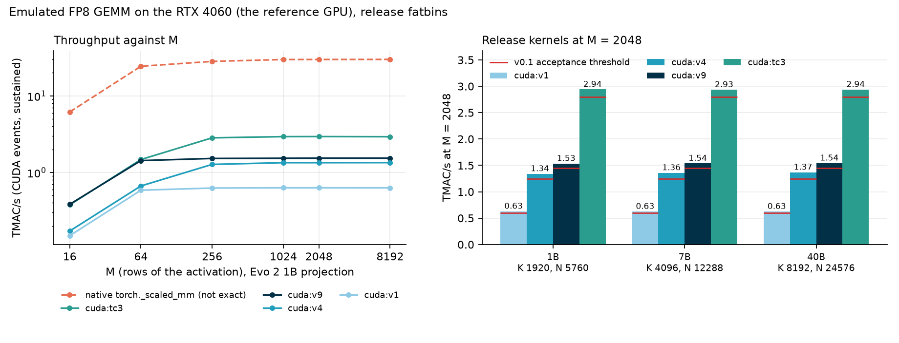

# Performance

Emulating FP8 tensor-core arithmetic exactly costs far more than running it natively. This page says how mmaemu
measures speed, what the kernels are expected to reach on the reference GPU, and where the measured release
numbers are recorded.

## Method

All GPU timings use **CUDA events**. Host timers are not used for kernel throughput: on the WSL2 reference host
`time.perf_counter` ran 6-10% fast against an external clock during the audit, which biased every throughput
computed from it. The kernel benchmark (`tools/bench_kernels.py` in the repository):

- checks the full output of the timed kernel bitwise against v1 or the reference before timing;
- warms up for at least 1.5 s, then times windows of at least 1.0 s (sustained load: the RTX 4060 reaches its
  power limit and lowers its clock, so short bursts overstate throughput by 5-10%);
- samples the SM clock and power with `nvidia-smi` and reports TMAC/s (10^12 multiply-accumulates per second) and
  MAC per clock per SM;
- refuses to run when the host clock check (`tools/hostclock.py`) reports a perf_counter drift above 0.2% and no
  CUDA events are in use;
- measures performance on locally built release-flag fatbins only. NVRTC-compiled kernels are checked for equal
  bits; their speed is recorded but not used for thresholds.

## Release measurements on the RTX 4060 (T6)

T6 ran on 2026-10-14 on the profile device with the frozen release fatbins of da9edd4, loaded as users get them
(source `fatbin`; the image sha256 of every kernel equals the release manifest). The host and its software are
recorded in `log:docs/validation_logs/2026-10-14/rtx4060-host/README.md`, the reports in
`log:docs/validation_logs/2026-10-14/t6-rtx-4060-sm89/README.md`. Every timed kernel's output was first checked
bitwise against v1 (v1 against the CPU reference) at every M: 0 mismatches.

Sustained TMAC/s at M = 2048 for the Evo 2 shapes, Gaussian data (MAC per clock per SM in parentheses):

| Implementation | 1B (K 1920, N 5760) | 7B (K 4096, N 12288) | 40B (K 8192, N 24576) | v0.1 acceptance threshold | Audit (prototype, 1B) |
|---|---:|---:|---:|---:|---|
| native `torch._scaled_mm` (fast accumulation; not exact) | 29.8 | 30.4 | 30.5 | (reference) | about 30-32 |
| tc3 (fp16 tensor-core "dummy accumulator", gated; sm_80/86/89 binaries) | 2.94 (49.0) | 2.93 (49.7) | 2.94 (50.1) | >= 2.8 | 2.94-3.02 |
| v9 (bf16 tensor cores for exponents, gated) | 1.53 (26.7) | 1.54 (27.2) | 1.54 (27.1) | >= 1.45 | 1.55-1.58 |
| v4 (CUDA cores, IEEE-defined instructions only; sm_80+) | 1.34 (22.3) | 1.36 (22.8) | 1.37 (23.2) | >= 1.25 | 1.30-1.38 |
| v1 (CUDA cores, IEEE-exact; sm_75+) | 0.63 (10.4) | 0.63 (10.4) | 0.63 (10.5) | >= 0.60 with the shared-memory decode table (shipped), else >= 0.48 | 0.51-0.53; about 0.66 with the shared-memory table |
| float64 reference, CPU (8 threads) | | | | none | 116-181 MMAC/s |

- Every kernel is above its threshold on every shape. On the 1B shape tc3 (at the low end) and v4 lie inside the
  audit's ranges of the prototypes; v9 is 1-3% and v1 about 5% below them. The shipped v1 is the DEC1 variant,
  which measured 0.636 on the same GPU in development (backends.md, "v1 variant decision").
- Native FP8 reaches 29.8-30.5 TMAC/s at M = 2048, about 500 MAC/clk/SM, as in the audit on the recording host
  (30-32). From M = 256 on, the emulated GEMM with tc3 is about 10x slower than native (16-17x at M = 16 and 64).
  The test host's PCIe Gen3 x8 link does not enter: the operands stay on the GPU.
- The GPU runs at its 115 W power limit throughout: the clock-event reason "SW power cap" appears in every
  measurement, the SM clock averages 2.36-2.58 GHz at M >= 256, and the driver's power average is 109-115 W.
  MAC/clk/SM divides out the clock, so it is the figure to compare across hosts.
- The data does not change the speed: with the adversarial generator of the self-test, every kernel is within 1%
  of its Gaussian rate at every M and shape (ratios 0.990-1.006). The speed on real Evo 2 operands was not timed
  separately; their bits are checked by T3 (device independence: the full accumulators of all 21 Evo 2 1B
  projections, for every kernel).

Throughput against M, Evo 2 1B shape:

| M | tc3 | v9 | v4 | v1 | native | native / tc3 |
|---:|---:|---:|---:|---:|---:|---:|
| 16 | 0.378 | 0.384 | 0.172 | 0.149 | 6.17 | 16x |
| 64 | 1.475 | 1.429 | 0.666 | 0.586 | 24.4 | 17x |
| 256 | 2.831 | 1.524 | 1.273 | 0.626 | 28.2 | 10x |
| 1024 | 2.936 | 1.532 | 1.341 | 0.630 | 29.8 | 10x |
| 2048 | 2.941 | 1.535 | 1.340 | 0.630 | 29.8 | 10x |
| 8192 | 2.928 | 1.535 | 1.343 | 0.630 | 29.9 | 10x |

Small M has too little parallel work for 24 SMs: at M = 16 every kernel runs at an eighth to a quarter of its
M = 2048 rate, and v9 is as fast as tc3 there (0.384 against 0.378 TMAC/s). AUTO does not depend on M and selects
tc3 at every size; from M = 256 on tc3 is about 1.9x faster than v9.

## Selection

With `backend="auto"`, mmaemu uses the highest-priority kernel that loads and passes its gates on the device:
tc3 > v9 > v4 > v1 > reference. `python -m mmaemu info` shows the status of each, with the reason when one is
unavailable; `python -m mmaemu selftest --force` re-runs the gates.

## What this means end to end

For Evo 2 1B on the RTX 4060 the audit measured the emulated FP8 projections as the dominant cost of an emulated
forward pass with the prototype v1 kernel: about 95% of the extra time over native, and about 3.6x the native time
in all (paired measurement). With tc3, about 10x slower than the native GEMM (T6 above), the emulated forward
pass on the RTX 4060 is expected to take roughly 1.5-2x the native time. That is an estimate from the kernel rates;
it was not measured.

The measured end-to-end figure is from the RTX 5070 Ti, where AUTO selects v4: an 8,192-bp Evo 2 1B forward pass
takes about 1.0 s with mmaemu against 0.45 s natively (host timer; [evo2.md](evo2.md)). It is a different GPU and
kernel from the estimate above.

On the CPU the float64 reference is practical for tests and single projections, not for whole models.
